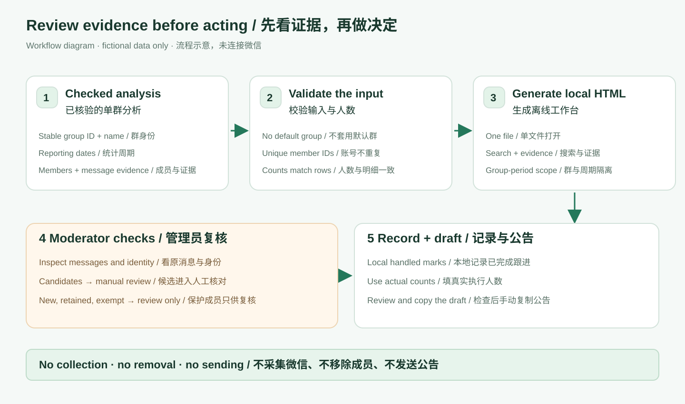
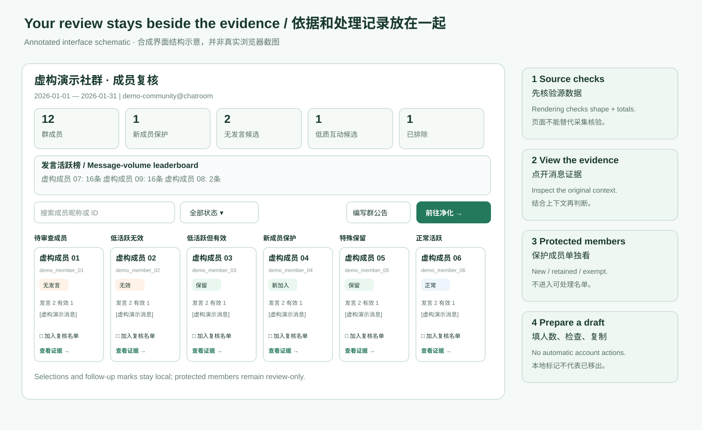

# Community Review Workbench

[简体中文](README.zh-CN.md) · [Input contract](references/review_workbench_contract.md) · [Synthetic demo](examples/analysis.json)

**Turn an already checked group-activity report into a local page where you can inspect message evidence, select members for review, record follow-ups, and prepare an announcement.**

Repeatedly jumping between member lists, messages, and a spreadsheet makes community review hard to finish. This workbench keeps the evidence and your decisions together. You provide a single-group analysis JSON; it produces one self-contained HTML file. Open it locally and review at your own pace.

This release is an **offline review tool**. It does not collect WeChat data, determine who should be removed, send announcements, or remove members. Real-time collection is outside this release. The earlier collector used an older CLI interface and is intentionally excluded; see [collection boundaries](docs/collection-boundaries.md).



## Typical situations

- A moderator has a monthly activity report and wants to review silent or low-activity members with their message evidence before contacting anyone.
- A community manager needs a separate place for uncertain identities, newcomers, administrators, and members who should be retained.
- Two groups share the same display name. The manager needs distinct files and browser state, so one group's selections do not appear in another.
- Several review sessions happen over a week. Local selection, follow-up marks, and announcement drafts should survive reopening the same file in the same browser context.

## Try it with fictional data

Install Python 3.10 or newer. The renderer uses only Python's standard library; no account, API key, package installation, or WeChat access is needed for this demo. Node.js is optional for the interaction tests.

1. Download this repository with **Code → Download ZIP**, unzip it, and open a terminal in the extracted directory. Or clone it:

   ```bash
   git clone https://github.com/mileson/wechat-group-hygiene.git
   cd wechat-group-hygiene
   ```

2. Generate a page using the clearly labeled fictional example:

   ```bash
   python3 -B scripts/demo.py
   ```

3. Open `examples/demo-workbench.html` in a browser. You should see 12 fictional members, several activity categories, and a message-activity leaderboard. The file is generated locally and ignored by Git.
4. Search for a member, inspect **查看证据** (View evidence), select a review card, and click **前往净化 →** (Open review list). Newcomers and protected members are kept in the review-only section.
5. Mark a follow-up as handled only after you actually complete it outside this tool. Open the announcement dialog, fill in the actual numbers, review the draft, then copy it manually.

The generated interface is currently Chinese. The documentation is available in English and Chinese. The demo is illustrative and contains no real members or chat history.

## What it can do



| Capability | What you get | What remains your responsibility |
| --- | --- | --- |
| Single-file output | Embedded styles and scripts; no external page dependencies | Keep the file and the underlying data private |
| Activity overview | Member counts and supplied status totals | Verify the collection scope and source totals first |
| Leaderboard | Up to 10 members with messages, sorted by message count, then valid count and stable username | Message volume is not a quality score |
| Review cards | Message, valid/invalid, and reply counts; latest sample; supplied status | Supply the classifications; the renderer does not infer them |
| Evidence dialog | Escaped message text, times, reasons, and optional AI-review explanation | Check context and identity before acting |
| Search and filters | Search by display name or username; keyboard-operable status selector | A hidden card is still included in its section's select-all operation |
| Batch selection | Select/unselect the whole candidate section, including filtered cards | Inspect the resulting shortlist |
| Protected review | Newcomers, special-keep, and excluded members enter a separate review-only area | Maintain the protection policy in your analysis source |
| Follow-up records | Local handled/unhandled marks; removing a card from the shortlist preserves its previous mark | These are browser records, not a confirmation of WeChat actions |
| Announcement draft | Editable dates, counts, optional rules, and a copy action; rate = actual removed / original member count | Supply valid numbers and check wording before copying |
| Group isolation | Full group ID + reporting period in storage keys; group name + full-ID digest in output filenames | Provide a stable group ID and name; neither has a default |
| Input gates | Reject missing metrics, duplicate usernames, invalid dates, mismatched totals, or conflicting identities | A structurally valid report may still contain incomplete or incorrect source evidence |
| Atomic output | Validation occurs before writing; successful writes use a temporary file and atomic replacement | Preserve your source analysis and backups |

## Use your own checked report

```bash
python3 -B scripts/render_review_workbench.py \
  --analysis-json ./private-analysis.json \
  --output-html ./private-review.html
```

Both `chatroom_id` and `group_name` must be in the JSON or explicitly provided:

```bash
python3 -B scripts/render_review_workbench.py \
  --analysis-json ./private-analysis.json \
  --chatroom-id 'YOUR_STABLE_GROUP_ID' \
  --group-name 'Your community' \
  --output-html ./private-review.html
```

Explicit values must match any identity already in the JSON. Missing identity is an error: the tool never silently chooses a group. Without `--output-html`, the output goes beside the input, with a group-specific filename.

Before using real data, independently check the message total and complete pagination, the current member baseline, sender-to-member mapping, ambiguous identities, date range, and exemptions. Successful rendering confirms the input shape and supplied totals only. The tool cannot inspect those upstream checks.

## Input and output

The [complete contract](references/review_workbench_contract.md) explains all fields. Start with [examples/analysis.json](examples/analysis.json). A member row includes a stable `username`, a display name, one supported status, four nonnegative activity counters, an interaction flag, and message evidence. Zero means a known zero; do not substitute it for missing information.

Supported statuses: `confirmed_inactive`, `confirmed_low_invalid`, `low_activity_needs_review`, `low_activity_kept`, `recent_joiner`, `special_keep`, `normal_activity`, `excluded`.

Output is one HTML file. No selection-export button or automated account action is included. Announcements and review state are stored locally in the browser when storage is available.

## Use as an Agent Skill

Copy the repository into your agent's skill directory as `wechat-group-hygiene`, following that agent's skill-loading mechanism. The entry point is [SKILL.md](SKILL.md). You can also use the command-line renderer directly without an AI agent. Example request:

> Use this verified single-group analysis JSON to create a local review workbench. Keep newcomers and protected members review-only. Do not connect to WeChat or perform any account actions.

## Questions beginners often ask

**Can I use it without connecting WeChat?** Yes. The fictional demo and renderer run entirely offline. For your own community, provide an analysis report that you have already checked through an independently maintained collection process.

**Does it find inactive members automatically?** No. The report supplies each member's status. The page organizes that status and its evidence so a moderator can decide.

**Does “handled” mean the member was removed in WeChat?** No. It is a local note. Make the real decision and action separately, then record it if appropriate.

**Will an excluded member accidentally join the actionable list?** Newcomers, special-keep, and excluded members can be selected for inspection but appear only in the protected section and have no processing toggle.

**Why was my JSON rejected?** Common causes are missing group identity, unknown statuses, missing counters, duplicate usernames, invalid date ranges, or totals that do not match the rows. Read the error and fix the source; don't invent values just to pass validation.

**Can I review several groups?** Generate one file per group. State is scoped to the full group ID and date range. Cross-group statistical merging is not included in this renderer.

**Why did my selections disappear?** State depends on the browser's local storage and origin/file handling. Another browser, private browsing, clearing storage, a renamed file, or storage being blocked can change persistence. There is no server backup or cross-device sync.

**Can another moderator see my selections?** Not automatically. Opening a copy gives that moderator their own browser state; this is a personal review workbench rather than collaborative cloud software.

**Can I publish the resulting page?** A real report contains member identities and message excerpts. Keep it local or share it only with the people authorized to see that information. Public examples must be fully synthetic.

**Does this validate WeChat collection or the browser display?** No. The bundled tests check generated markup and synthetic interaction state without opening a browser or connecting WeChat. Inspect the resulting page in your own environment before operational use.

## Development and verification

```bash
python3 -B -m unittest discover -s tests -p 'test_render_review_workbench.py' -v
```

The test suite covers input gates, identity isolation, safe rendering, leaderboard ordering, protected members, output preservation, and local interactions. Node.js, when present, runs the bundled synthetic-DOM interaction checks; otherwise that check is explicitly skipped. No browser, server, or WeChat session is started.

## Privacy and contributions

Only fictional member data is bundled. There are no group defaults, personal exemption lists, private execution history, credentials, or inherited Git history. Keep real analyses, output pages, and account configuration outside the repository. Do not attach private reports to issues. Share a small synthetic reproduction instead.

See [CONTRIBUTING.md](CONTRIBUTING.md) and [SECURITY.md](SECURITY.md). Licensed under [MIT](LICENSE), copyright 2026 mileson.
